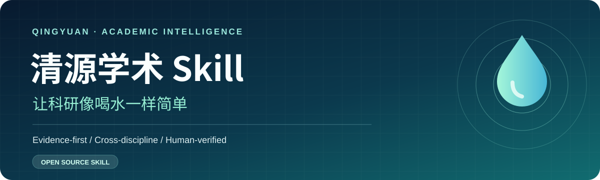

# Qingyuan Academic Skill

> Research as simple as drinking water. Simplify the workflow, never the evidence.

**Qingyuan Academic Skill** is an evidence-first, model-agnostic research and writing workflow for STEM, medicine, social sciences, humanities and law.

[中文](README.md) · [Skill entry](SKILL.md) · [Full Chinese handbook](docs/full-handbook.md) · [Author](https://github.com/3150214587)

## Capabilities

- Build research briefs, evidence inventories and gap reports before drafting.
- Synthesize and compare scholarship by methods, data, findings and limitations.
- Adapt to empirical, qualitative, theoretical, doctrinal and review research.
- Draft one section at a time; audit references, claims, logic, ethics and AI disclosures.

## Quick start

Read `prompts/00-start.md`, add real source materials, choose a route and finalize with `prompts/04-quality-audit.md`. For agents, load `SKILL.md` from this directory. User remains accountable for real research and final submissions.

Maintainer: [@3150214587](https://github.com/3150214587) · [MIT License](LICENSE).
