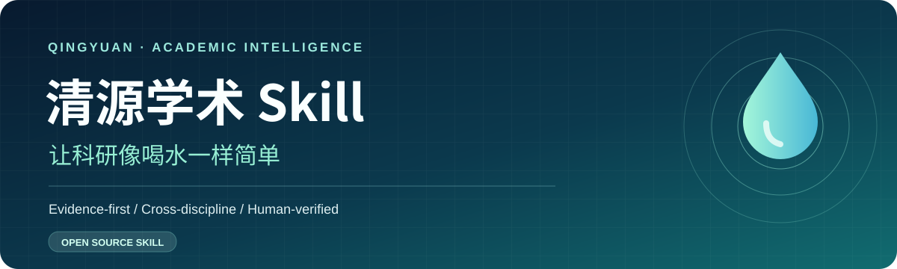
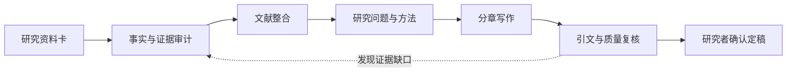

<div align="center">



<br />

**从一个研究问题，到一篇有证据、有结构、经得起核查的学术作品。**

[](https://github.com/3150214587/qingyuan-academic-skill/actions/workflows/docs.yml)
[](CHANGELOG.md)
[](LICENSE)
[](docs/full-handbook.md)
[](SKILL.md)
[](docs/full-handbook.md)

[**📘 完整手册**](docs/full-handbook.md) · [**⚡ 立即开始**](#-三分钟快速开始) · [**🧩 Agent Skill**](SKILL.md) · [**🔎 证据核验**](prompts/04-quality-audit.md) · [**English**](README.en.md)

</div>

---

## 🌊 清源学术是什么？

**清源学术 Skill（Qingyuan Academic Skill）** 是面向研究生、教师和研究者的开源学术研究与写作工作流。它不是“输入题目后一键生成论文”的代写器，而是一套让 AI **读懂研究材料、规划研究论证、组织文献、辅助写作并审计证据**的可复用能力。

> **让科研像喝水一样简单。** 简化的是流程、工具与组织成本；不简化研究真实性、伦理与学术质量。

## ✨ 为什么用清源？

| 传统 AI 写论文 | 清源学术 Skill |
|:---|:---|
| 一次性生成整篇，错误难发现 | **阶段式交付**：先研究资料卡，再按章节写作 |
| 引用真假混杂 | **证据台账**：核心论断关联原文、数据与定位 |
| 统一套用实验论文格式 | **跨学科适配**：理工、医学、社科、人文、法学 |
| 写作时擅自“补齐”缺失结果 | **事实边界**：缺证据就标记，绝不伪造 |
| 文献逐篇排队介绍 | **综合式综述**：围绕方法、分歧与证据比较 |
| 改稿只做语言润色 | **质量闸门**：结构、论证、引用、反例和伦理逐层检查 |

## 🧭 一张图看懂工作流



## ⚡ 三分钟快速开始

**方式 A：直接在 ChatGPT / Claude / Gemini 等对话工具使用。**

1. 打开 [一键启动提示词](prompts/00-start.md)，复制到新的对话。
2. 填写 [研究资料卡](prompts/00-start.md#研究资料卡)，上传真实资料与已有文献。
3. 选择研究路线：`原始研究 / 综述 / 定性研究 / 人文法学`，按检查结果逐章推进。
4. 写作结束后运行 [学术质量审计](prompts/04-quality-audit.md)，人工核对后再使用。

**方式 B：作为 Agent Skill 安装。**

将本目录保存至 Agent 支持的 Skills 路径（例如 Codex 通常使用 `~/.agents/skills/qingyuan-academic/`；其他工具请按各自文档配置），确保 `SKILL.md` 与 `prompts/`、`docs/` 同级。然后在对话中提出：

```text
请使用清源学术 Skill，对我的研究资料执行第一轮研究资料审计。不要直接生成整篇论文。
```

> 不必依赖某个特定型号的 AI。若 Agent 无法访问文件或网络，应明确说明其核验能力边界。

## 🧩 模块全景

| 模块 | 你可以完成的事 | 文档入口 |
|---|---|---|
| 💧 研究启动 | 资料卡、事实边界、研究计划 | [Start](prompts/00-start.md) |
| 📚 文献综合 | 证据矩阵、文献比较、研究缺口 | [Literature](prompts/01-literature.md) |
| ✍️ 论文写作 | 摘要、引言、方法、结果、讨论 | [Writing](prompts/02-writing.md) |
| 🧭 学科适配 | 定量 / 定性 / 理工 / 人文 / 法学 / 综述 | [Discipline](prompts/03-discipline.md) |
| 🛡️ 质量控制 | 引用真伪、逻辑链、证据核查与返修 | [Audit](prompts/04-quality-audit.md) |
| 📖 完整指令库 | 全部 P、R、G、Q、H 模块可复制提示词 | [V3 手册](docs/full-handbook.md) |

## 🧪 两个使用场景

<details><summary><strong>案例 A：科研新人想做文献综述</strong></summary>

上传你真正找到的论文清单，然后让清源先做“问题-方法-证据-局限”对照表，而不是立即拼接摘要。缺失全文的文献标为“仅看摘要”，不自动生成不存在的实验数据。

使用：[文献综合](prompts/01-literature.md) + [综述写作](docs/full-handbook.md)
</details>

<details><summary><strong>案例 B：有真实实验或访谈数据，准备写学位论文</strong></summary>

将研究设计、原始数据说明、已完成分析和引用清单加入资料卡。清源梳理哪些结论有证据支持、哪些地方还需要计算或查证，再协助按合适的研究类型起草章节。

使用：[研究启动](prompts/00-start.md) + [论文写作](prompts/02-writing.md) + [质量审计](prompts/04-quality-audit.md)
</details>

## 📂 项目结构

```text
qingyuan-academic-skill/
├── README.md                 # 中文介绍页
├── README.en.md              # English overview
├── SKILL.md                  # 可被 Agent 读取的技能入口
├── assets/qingyuan-hero.svg  # 官方项目横幅
├── prompts/                  # 直接可复制的五套提示词
├── docs/full-handbook.md     # 完整 V3 学术写作指令库
├── examples/                  # 标准使用示例
├── CONTRIBUTING.md           # 参与维护
├── CHANGELOG.md              # 更新日志
└── LICENSE                   # MIT License
```

## 🛡️ 学术诚信是底线，不是选项

清源不会把“可能正确”说成“已经证实”，不会在没有数据时杜撰实验结果，也不会把未读到的论文说成已阅读全文。作者必须亲自确认研究设计、伦理审批、真实数据、引用和最终稿。对综述论文，应根据实际采用的综述类型决定是否适用 PRISMA 等报告规范。

## 🤝 参与贡献

欢迎提交使用反馈、提示词改进、学科适配方案与真实（已脱敏）示例。参见 [CONTRIBUTING.md](CONTRIBUTING.md)。本项目由 [@3150214587](https://github.com/3150214587) 维护，AI 参与了内容起草和文档设计；所有正式研究成果仍由研究者本人负责。

<div align="center">

---

### 💧 让科研像喝水一样简单

**让想法更清楚，让证据更扎实，让写作更从容。**

[GitHub 作者主页](https://github.com/3150214587) · [项目入口](https://github.com/3150214587/qingyuan-academic-skill) · [MIT License](LICENSE)

</div>